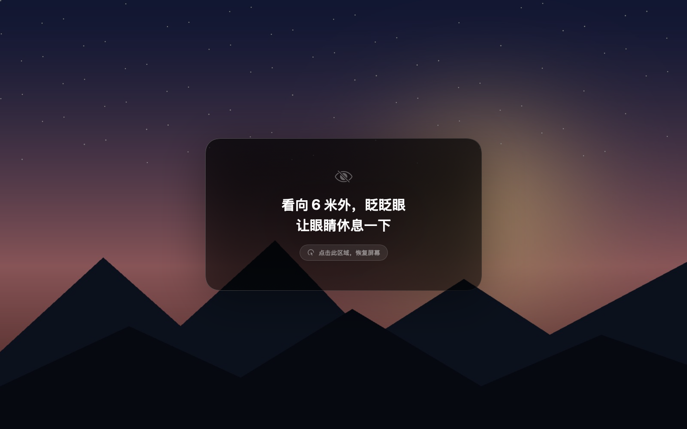

# Eyes Protecter

> 到点了，就把屏幕整个暗下来，直到你真的让眼睛离开一会儿。

**Eyes Protecter** 是一个常驻 macOS 菜单栏的护眼提醒工具：每隔一段时间，所有屏幕逐渐变暗至全黑，屏幕中央浮现一句自定义文案；只有点击这张文案卡片，屏幕才会逐渐恢复，并重新开始倒计时。

默认是纯黑背景，也可以在菜单栏里选择一张自己的图片，休息时铺满整个屏幕。

使用 **Swift + SwiftUI** 编写，只依赖 **Command Line Tools**（不需要完整 Xcode），没有第三方库，也没有私有 API。当前版本 **2.1.0**，Universal 2 构建，Apple Silicon 与 Intel Mac 都可以运行。

- 项目主页：<https://github.com/guoruibiao/eyes-protecter>
- 作者：泰戈尔 · <https://github.com/guoruibiao>

<p></p>



## 功能

- 菜单栏空闲时使用小苗 template 图标，暂停/休息时切换状态图标，并显示倒计时
- 菜单面板左上角使用同款小苗 App 图标，界面强调色与图标绿色保持一致
- 休息间隔 1–180 分钟可调，内置 15 / 20 / 30 / 45 / 60 分钟快捷选项
- **变暗时长**（进入休眠的过渡时间）1–20 秒可调，**默认 10 秒**
- **休眠画面**可自定义：默认纯黑，也可以选择一张图片铺满所有屏幕
- 文案自定义，支持多行
- 总开关（暂停 / 继续）、立即休息、重新计时
- 面板高度自动适配屏幕，小屏可滚动；品牌绿强调色与图标一致
- 多显示器同步遮罩，完整覆盖菜单栏、Dock 和全屏 Space
- 设置自动保存；图片会复制到 Application Support，原图移动或删除也不影响
- 遮罩完全变黑后自动收起鼠标指针，移动鼠标即重新出现
- 从旧版 Move Ur Eyes 升级时，会自动迁移原有的设置和休眠背景图

## 下载与安装

发布版会放在 **GitHub Releases**：

<https://github.com/guoruibiao/eyes-protecter/releases>

下载 `Eyes-Protecter-2.1.0.zip` 或 `.dmg` 后：

1. 解压 zip（或双击 dmg 并把 App 拖入「应用程序」）。
2. 将 `Eyes Protecter.app` 放入 `/Applications`。
3. 第一次打开如果被 Gatekeeper 拦住，右键 App → **打开**，或在终端执行：

```bash
xattr -dr com.apple.quarantine "/Applications/Eyes Protecter.app"
open "/Applications/Eyes Protecter.app"
```

> 当前发布包使用本地 ad-hoc 签名，未经过 Apple 公证，所以从网络下载后可能触发 Gatekeeper 提示。若要完全消除这个提示，需要使用 Apple Developer ID 签名并公证，见下方「发布新版本」。

如需开机自启：**系统设置 → 通用 → 登录项 → 打开时添加“Eyes Protecter”**。

## 系统要求

- macOS 13 Ventura 或更高
- Apple Silicon 或 Intel 芯片（Universal 2，同一份 App 同时包含 arm64 和 x86_64）
- Xcode Command Line Tools

菜单栏面板底部的「关于」展开后会显示当前 macOS 版本、芯片类型以及是否满足运行条件。

```bash
xcode-select --install
swift --version
```

## 构建与运行

```bash
./scripts/build-app.sh --open
```

或者分两步：

```bash
./scripts/build-app.sh
open "dist/Eyes Protecter.app"
```

也可以使用 Makefile：

```bash
make open
```

构建产物：`dist/Eyes Protecter.app`。

构建脚本会分别编译 arm64 与 x86_64，再用 `lipo` 合并成 Universal 2。首次构建两个架构会慢一些，之后是增量编译。

## 使用

1. 启动后菜单栏会出现眼睛图标和倒计时。
2. 点击图标打开设置面板：
   - 右上角开关：暂停 / 继续计时
   - **现在休息**：立即预览一次完整的变暗流程
   - **重新计时**：把倒计时重置为一个完整间隔
   - **休息间隔**：用步进器或快捷按钮设置
   - **进入休眠 → 变暗时长**：屏幕渐变到黑的秒数，默认 10 秒
   - **休眠画面**：保持纯黑，或点击“选择图片…”挑一张图片；已设置后可“更换”或点垃圾桶恢复纯黑
   - **休息文案**：支持多行
   - **关于**：默认折叠，点击展开软件说明、作者泰戈尔、GitHub 主页、版本号，以及最低系统要求、当前 macOS 版本/芯片和兼容状态
3. 倒计时结束后：
   - 所有屏幕在设定时间内渐暗到全黑；
   - 如果设置了图片，图片会在黑色完全盖住后淡入并铺满屏幕；
   - 中央浮现文案卡片；
   - 点击卡片任意位置，屏幕在设定时间内渐亮恢复，随后重新开始倒计时。

默认设置：每 **20 分钟**休息一次，**10 秒**变暗，**3 秒**恢复，纯黑背景。文案为空时会使用兜底提示“让眼睛休息一下”。

### 关于自定义图片

- 图片会按“铺满屏幕”的方式裁切（aspect fill），横图、竖图都可以，横图效果最好。
- 图片上会叠一层约 38% 的黑色遮罩，文案卡片使用深色底，保证白字可读，同时保留图片氛围。
- 图片是**复制**到 `~/Library/Application Support/Eyes Protecter/background.image` 的，不是引用原路径。
- 如果不再需要，点击休眠画面一行的垃圾桶即可删除并恢复纯黑。

## 实现方式

- **菜单栏**：SwiftUI `MenuBarExtra(.window)`；设置面板全部由 SwiftUI 实现。
- **状态机**：`AppModel` 管理 `idle / paused / breaking / restoring` 四种状态，使用墙钟时间计算剩余秒数；睡眠唤醒后重置计时，避免一醒来就被黑屏。
- **遮罩**：`BreakOverlayController` 为每个 `NSScreen` 创建一个无边框、非激活的 `NSPanel`，层级 `.screenSaver`，加入所有 Space 并支持全屏应用；用 `NSAnimationContext` 对窗口 `alphaValue` 做渐变动画。
- **完整覆盖菜单栏**：纯黑底和背景图片都由 AppKit 的 `OverlayBackgroundView` 绘制，frame 与窗口内容区完全一致，而不是只依赖 SwiftUI 的 `Color.black`。这样即使顶部有菜单栏/刘海安全区，也会被背景层完整覆盖；图片通过 `CALayer.contentsGravity = .resizeAspectFill` 铺满每个屏幕。
- **点击**：在 `NSPanel.sendEvent` 中按窗口坐标判断是否命中卡片矩形。这样点击不依赖 SwiftUI 或 AppKit 的“首次点击激活窗口”逻辑，第一下点击就能生效。
- **文案卡片**：SwiftUI 视图在黑屏完全盖住后淡入；有图片时自动切换为深色卡片底，保证对比度。
- **持久化**：设置保存在 `UserDefaults`（`~/Library/Preferences/com.guorui.eyes-protecter.plist`），背景图复制到 Application Support。

### 为什么用遮罩而不是调系统亮度？

macOS 没有公开的“设置显示器亮度”API。常见做法是调用私有 `DisplayServices` 接口，但兼容性和签名风险较高，而且单纯降低亮度未必能“完全看不见”。对护眼场景来说，直接覆盖一层可渐变的黑色窗口更可靠，也能保证多显示器、外接屏、菜单栏和全屏应用行为一致；恢复时遮罩淡出，原来的画面原样回来。

## 发布新版本 / 分发

GitHub Releases 是最适合放「已经编译好的 App」的位置：源码留在仓库里，二进制作为 release asset 上传，用户点开 Releases 页面即可下载，不需要把 `.app` 提交到 Git。

### 一键打包 zip / DMG

```bash
./scripts/package-release.sh
```

脚本会：

1. 读取 `Info.plist` 里的版本号；
2. 生成 `dist/Eyes-Protecter-<版本>.zip`；
3. 生成带 Applications 快捷方式的 `dist/Eyes-Protecter-<版本>.dmg`；
4. 生成 SHA-256 校验文件。

> 如果脚本运行在受限沙盒里，`hdiutil` 可能无法创建 DMG；此时会保留 zip 并给出提示，在普通终端重跑即可生成 DMG。

### 上传到 GitHub Releases

**网页方式：**

1. 打开 <https://github.com/guoruibiao/eyes-protecter/releases/new>
2. Tag 填 `v2.1.0`，标题填 `Eyes Protecter 2.1.0`
3. 把 `dist/Eyes-Protecter-2.1.0.zip` 和 `.dmg` 拖入 Assets
4. 发布

**命令行方式（需要 GitHub CLI 并已登录）：**

```bash
gh release create v2.1.0 \
  "dist/Eyes-Protecter-2.1.0.zip" \
  "dist/Eyes-Protecter-2.1.0.dmg" \
  --title "Eyes Protecter 2.1.0" \
  --notes "Eyes Protecter 2.1.0"
```

发布后的下载地址形如：

```text
https://github.com/guoruibiao/eyes-protecter/releases/latest
```

### 消除 Gatekeeper 提示（正式分发建议）

当前构建是 ad-hoc 签名。要让其他用户下载后直接双击打开，需要 Apple Developer ID 签名 + 公证：

```bash
codesign --deep --force --options runtime \
  --sign "Developer ID Application: YOUR NAME (TEAMID)" \
  "dist/Eyes Protecter.app"

ditto -c -k --sequesterRsrc --keepParent \
  "dist/Eyes Protecter.app" \
  "dist/Eyes-Protecter-2.1.0.zip"

xcrun notarytool submit "dist/Eyes-Protecter-2.1.0.zip" \
  --apple-id "you@example.com" \
  --team-id "TEAMID" \
  --password "app-specific-password" \
  --wait

xcrun stapler staple "dist/Eyes Protecter.app"
```

没有开发者账号时，GitHub Releases 仍然可以分发，但用户首次打开需要右键 → 打开，或手动移除 quarantine。

## 目录结构

```
Sources/EyesProtecter/
  EyesProtecterApp.swift     入口、MenuBarExtra、AppDelegate
  AppModel.swift             设置、倒计时、休息状态机、背景图持久化、旧版数据迁移
  BreakOverlay.swift         每屏遮罩窗口、渐隐渐现、点击命中
  OverlayBackgroundView.swift AppKit 全屏黑底 / 图片背景层
  OverlayCardView.swift      遮罩上的文案卡片
  SettingsPanel.swift        菜单栏设置面板
Resources/
  Info.plist
  AppIcon.icns               由小苗图生成
  MenuBarIcon.png            菜单栏小苗 template 图标
  IconSource.png             小苗原始透明图（152x150）
scripts/
  build-app.sh               arm64 + x86_64 编译、Universal 2 打包、ad-hoc 签名
  package-release.sh         生成 zip / DMG / SHA-256
  generate-icon.py           用 IconSource.png 重新生成 AppIcon.icns
  render-preview.swift       ImageRenderer 预览图生成（开发用）
previews/
  overlay.png                纯黑背景效果
  overlay-with-image.png     自定义图片效果
  sample-background.jpg      预览用示例图
  icon.png                   App 图标
```

> 图标原图是 152×150，生成 1024 图标时做了无损放大和轻微锐化。如果有高分辨率原图，替换 `Resources/IconSource.png` 后执行 `python3 scripts/generate-icon.py` 即可得到更锐利的图标。

## 开发

```bash
swift build                    # 只编译
./scripts/build-app.sh --open  # 打包并启动
```

构建脚本会把所有缓存放在项目内（`.build/`），并禁用 SwiftPM 自身的沙盒，因此在受限终端里也能构建（本项目没有第三方依赖）。

## 已知边界

- 这是视觉遮罩，不改变显示器硬件亮度；遮罩显示期间按亮度键仍会调整硬件亮度。
- 极少数窗口层级高于 `.screenSaver` 的系统 UI 可能出现在遮罩上方。
- 自定义图片按铺满屏幕裁切，超宽/超高图片会被裁掉边缘；建议使用横图。
- 最低支持 macOS 13（`MenuBarExtra` 的要求）；macOS 12 及更早的 Intel Mac 无法运行。
- 文案过长会自动缩小，建议控制在 6 行以内。
- 临时退出：先点击卡片恢复，再从菜单面板点“退出”；卡死时可在终端执行 `killall EyesProtecter`。

## 作者

泰戈尔 · [github.com/guoruibiao](https://github.com/guoruibiao)
